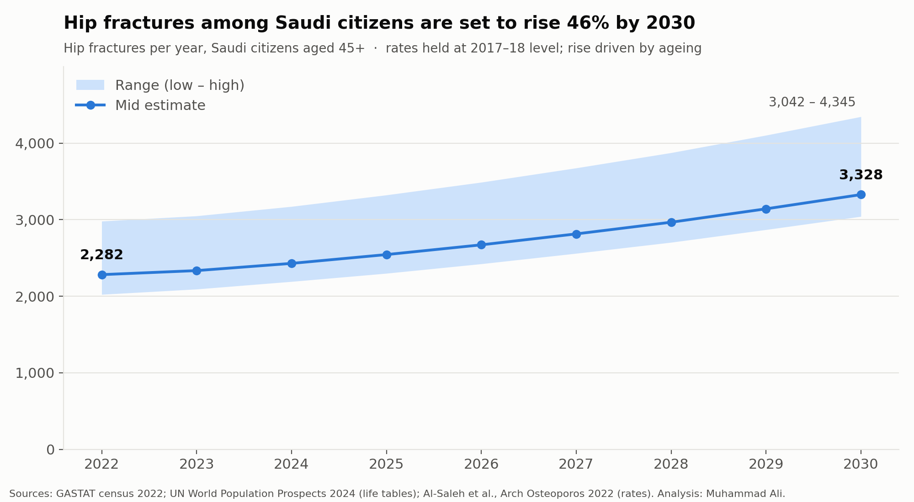
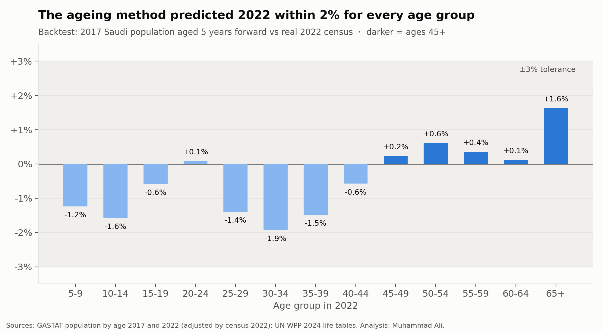
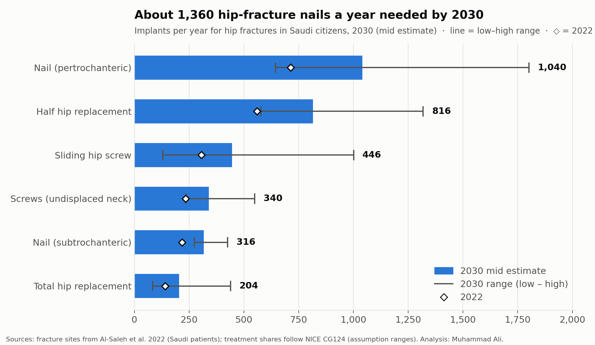

[hip_fracture_README.md](https://github.com/user-attachments/files/33373472/hip_fracture_README.md)
# Saudi Hip Fracture Demand to 2030

**How many hip fractures will Saudi citizens have in 2030, and what does that mean for implants and rehabilitation?**



## Headline (2030, Saudi citizens aged 45+)

| | Mid estimate | Range |
|---|---|---|
| Hip fractures per year | **3,328** | 3,042 – 4,345 |
| Growth since 2022 | **+46%** | driven only by population ageing |
| Hip-fracture nails | **1,356** | 917 – 2,227 |
| Hip replacements (half + total) | **1,019** | 824 – 1,465 |
| Physiotherapy sessions | **≈ 63,000** | 33,000 – 130,000 |
| Walking frames | **≈ 3,000** | 2,400 – 4,300 |

Between 2022 and 2030 the number of Saudi citizens aged 50+ grows by 48% (2.23 → 3.30 million), and the 65–79 group by 74%. Hip fracture rates are held at their 2017–18 level, so every additional fracture in this projection comes from ageing alone.

## Data (all public)

| Source | Used for |
|---|---|
| GASTAT Census 2022 (RCRC Open Data) – population by single year of age, sex and nationality | Starting population (18,792,262 Saudi citizens) |
| GASTAT population by age group 2010–2022, adjusted by census 2022 (via GLMM) | Backtest 2017 → 2022 |
| UN World Population Prospects 2024 – life tables (survivors l(x), complete) | Ageing the population year by year |
| UN World Population Prospects 2024 – population by 5-year age group and sex | Comparison with the published 2015 estimate |
| Al-Saleh et al., *Archives of Osteoporosis* 2022;17:56 – national hip fracture survey, 15 hospitals, 2017–18, 684 fractures | Age- and sex-specific rates; fracture sites (neck 43%, pertrochanteric 47%, subtrochanteric 10%) |
| NICE hip fracture guideline (CG124) | Which operation each fracture type usually receives |

## Method

1. **Population 2022** – census, Saudi citizens, single ages 0–100+.
2. **Ageing to 2030** – each year everyone moves up one age and only the UN life-table survival share survives (no migration for citizens; births not needed because everyone aged 45+ in 2030 was alive in 2022).
3. **Backtest** – the same method applied to 2017 predicts the real 2022 population **within 2% for every age group** (0.1–1.6% for ages 45+).

   

4. **Hip fractures** – Saudi rates per 100,000 by age and sex × projected population, in three scenarios:
   - **Low:** rates exactly as printed (80+ flat)
   - **Mid:** rates keep rising above 80 along the 70–80 trend up to age 90 (the paper states rates rise up to 90)
   - **High:** mid × 1.306, calibrated so that 2015 reproduces the paper's published 2,949
5. **Implants** – fractures split by the Saudi fracture-site shares, then by usual operation (assumption ranges, documented in `data/clean/treatment_assumptions.csv`). Each implant's range is the minimum and maximum over all 64 combinations of low/high assumptions.

   

6. **Rehabilitation** – physiotherapy sessions and walking aids per patient (assumption ranges in `data/clean/rehab_assumptions.csv`).

## How accuracy is proven

Every step has **gates**: automatic checks that stop the notebook if a number does not match its source. Each notebook ends with a **notebook gate** that re-reads the raw files from Drive.

| Notebook | Gates | Key proofs |
|---|---|---|
| `01_data_prep` | 55 | Census Saudi total = 18,792,262 exactly · all 444 clean cells equal the raw census · paper counts add to 296 + 388 = 684 · every printed rate recomputed from its counts |
| `02_model` | 64 | Backtest within ±3% (largest 1.93%) · **2030 result recalculated independently from the raw files with separate code: 3,327.55 = 3,327.55** · implants add up to operated fractures in all 64 combinations |
| `03_charts` | 23 | Every drawn bar and point equals the saved results · every README figure matches the saved files |

**Evidence-based decision:** the paper's last age row is printed "80–84", but its population ratio to the 75–79 row (1.22) matches the census ratio for 80+ (1.24), not 80–84 (0.66). It is therefore treated as 80+.

## Honest limitations

- **Gap with the published estimate:** the paper's rates applied to the current UN population give 23–29% fewer fractures for 2015 than the paper's 2,949, most likely because the paper used the older UN 2019 population revision. The high scenario is calibrated to the published figure, so the range covers both.
- Rates come from a hospital-based survey (2017–18) and are assumed constant; if rates rise, as the paper warns they may, the true numbers will be higher.
- Treatment and rehabilitation shares are assumptions with ranges (no Saudi registry data is published).
- The UN life table covers all residents and is applied to Saudi citizens; the census 100+ group is unusually large (very old ages are often over-reported), which is why the rate trend stops at 90.
- Non-Saudi residents are not included in the headline.

## What this means

- **For clinicians and rehab services:** about 3,300 older patients a year will need hip surgery and structured rehabilitation by 2030 – roughly 63,000 physiotherapy sessions – with women making up about 60%.
- **For orthopaedic companies:** demand for hip-fracture nails, hemiarthroplasty and total hip systems grows by about 45% in eight years, from ageing alone. Nails are the largest category (see also my FDA nail analysis, where 73% of nail breakages happened months after surgery, during healing).
- **With company data**, this model could be extended to regions, hospitals and product lines, and the assumption ranges replaced with real treatment data.

## Repository structure

```
data/raw/            original downloads, never edited
data/raw/manual_tables/  tables extracted from the PDFs, checked against their printed totals
data/clean/          outputs of the notebooks
notebooks/           01_data_prep · 02_model · 03_charts
figures/             the three charts
SOURCES.md           where every file came from
```

*Analysis: Muhammad Ali – Physiotherapist (DPT), healthcare data analysis.*
